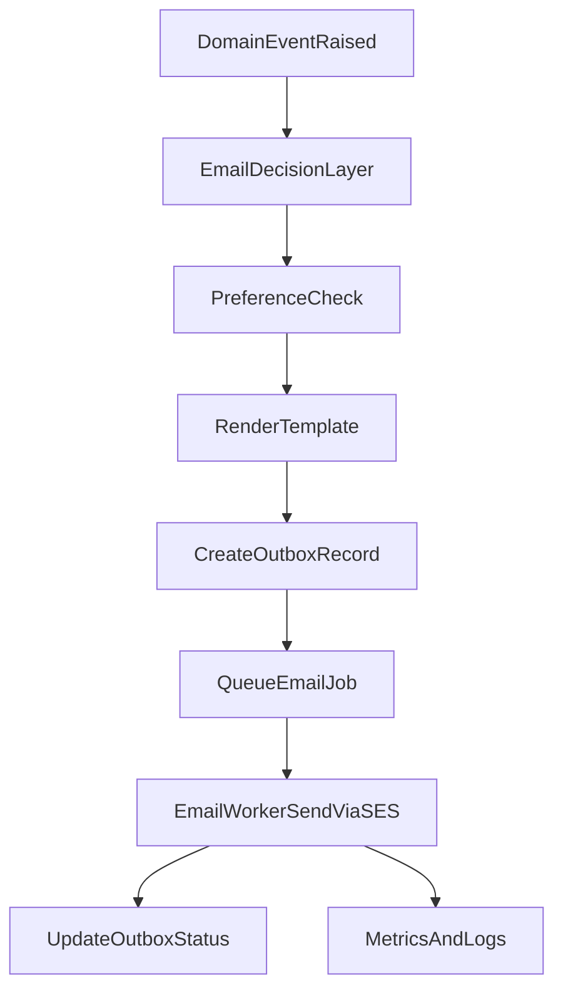

# PlotFarm Email System Review

## Executive Summary

PlotFarm already has a working transactional email foundation through AWS SES, but the current implementation is still very early-stage. Today, the system sends only a small set of user-facing emails, templates are embedded directly in TypeScript strings, some flows bypass the email queue entirely, and there is no centralized email catalog, template system, delivery audit trail, or category-based preference model.

The good news is that the existing setup is a strong low-cost starting point. PlotFarm does not need to switch providers right now. The best near-term path is to keep AWS SES for delivery, introduce a proper template layer, unify all sending through one queue-backed pipeline, classify emails by type, and add basic observability, rate limiting, and user preference controls. That approach keeps cost low while making the system much more maintainable, flexible, and scalable.

## Goals Of This Document

This document covers:

- What email capabilities currently exist
- Which emails are actively being sent versus only partially implemented
- What the current templates look like
- Where the present implementation is weak
- Which new email types PlotFarm should introduce
- How the email system should be structured following best practices
- A staged roadmap to move from the current setup to a robust system

## Current Implementation Status

To avoid ambiguity, PlotFarm now has two email states:

- `Live`: the email is wired to a real runtime trigger and should send in the product today
- `Ready`: the template and helper exist in the backend and can be triggered safely, but no product event is currently calling it automatically

### Live emails

- Registration OTP
- Email change OTP
- Welcome email after email registration completes
- Password reset
- Password changed confirmation
- Email changed confirmation to old email
- Email changed confirmation to new email
- Inquiry received
- Inquiry reply when the recipient is offline and has an email address
- Post approved
- Post rejected
- Post blocked
- Post unblocked / visible again
- Post removed by admin

### Ready emails

- New sign-in alert
- Unread inquiry digest
- Referral invite
- Weekly property digest
- Win-back / re-engagement
- Admin / system alert

## Current Architecture

### Delivery provider

PlotFarm currently uses AWS SES from the backend API.

- Email sending service: `plotfarm-api/src/modules/email/email.service.ts`
- Config mapping: `plotfarm-api/src/core/config/configuration.ts`
- Environment examples: `plotfarm-api/.env.example`

Current SES-related configuration:

- `SES_ENABLED`
- `SES_REGION`
- `SES_ACCESS_KEY_ID`
- `SES_SECRET_ACCESS_KEY`
- `SES_SOURCE_EMAIL`
- `SES_FROM_NAME`

Additional relevant config:

- `APP_BASE_URL` for password reset links
- `REDIS_ENABLED`, `REDIS_HOST`, `REDIS_PORT` for queue-backed email dispatch
- `OTP_EXPIRES_IN_MINUTES`, `OTP_MAX_ATTEMPTS` for OTP behavior

### Sending flow

Current flow is split across two pathways:

1. Direct send through `EmailService.sendMail()`
2. Queue-backed send through `NotificationsService` and BullMQ when Redis is enabled

This split is one of the main architectural weaknesses because not every email uses the same pathway.

### Queue support

PlotFarm has optional BullMQ queue support for email notifications:

- Queue name: `email_notifications`
- Processor: `plotfarm-api/src/modules/notifications/queues/email-notification.processor.ts`
- Wiring: `plotfarm-api/src/modules/notifications/notifications.module.ts`

Queueing only happens when `REDIS_ENABLED=true`.

Current limitation:

- No explicit retry policy
- No explicit backoff policy
- No dead-letter strategy
- No idempotency protection
- No persistent send audit or outbox record

## Current Email Inventory

### Emails that are actively sent today

These are the emails that are genuinely active in the current product.

#### 1. Registration OTP email

Purpose:

- Verify a user email during signup

Trigger:

- `AuthService.requestOtp()`

Delivery path:

- `NotificationsService.sendOtpEmail()`
- If Redis is enabled, job is queued
- Otherwise it falls back to `EmailService.sendOtpEmail()`

Audience:

- New user registering with email

Current subject:

- `Your PlotFarm Estate OTP`

Current variables:

- `otp`
- `expiresInMinutes`

Current content characteristics:

- Very short HTML
- Minimal plain-text fallback
- No branded layout
- No resend or support messaging

#### 2. Email change OTP email

Purpose:

- Verify ownership of a new email address before changing login email

Trigger:

- `UsersService.requestEmailChange()`

Delivery path:

- `NotificationsService.sendOtpEmail()`

Audience:

- Existing signed-in user changing account email

Current subject:

- `Your PlotFarm Estate OTP`

Current variables:

- `otp`

Important implementation note:

- This flow uses a different OTP storage mechanism from registration
- Registration OTPs are persisted in the database
- Email-change OTPs are kept in an in-memory `Map`

This means email-change verification is less durable and less scalable than registration OTP verification.

#### 3. Password reset email

Purpose:

- Send a reset link when a user requests password recovery

Trigger:

- `AuthService.forgotPassword()`

Delivery path:

- Direct call to `EmailService.sendPasswordResetEmail()`

Audience:

- Existing user who requested a password reset

Current subject:

- `Reset your PlotFarm Estate password`

Current variables:

- `resetToken`
- `appBaseUrl`
- `resetLink`

Important implementation note:

- This currently bypasses the queue flow and sends directly
- This creates inconsistent delivery behavior versus other email flows

### Emails that exist in code but are not actively wired into product flows

These appear to be helper methods or partial implementations, not currently active sends.

#### 4. Post approval notification email

Exists in:

- `EmailService.sendPostApprovalNotification()`
- `NotificationsService.sendPostApproval()`

Current status:

- Defined, but not found as an active trigger path elsewhere in the backend

Purpose if activated:

- Notify a seller that a post/property has been approved

#### 5. Property interest / inquiry notification email

Exists in:

- `EmailService.sendInterestNotification()`
- `NotificationsService.sendInterestNotification()`

Current status:

- Defined, but not found as an active trigger path elsewhere in the backend

Purpose if activated:

- Notify an owner that someone is interested in their property

### What is not present today

The following are notably absent:

- Welcome email
- Email verification success email
- Password changed confirmation email
- Login/security alert email
- Email change confirmation email to old address
- Post rejection email with reason
- Post blocked email with reason
- Inquiry reply/update email to buyer
- Reminder or digest emails
- Referral invite email sent by the backend
- Marketing/lifecycle campaigns
- Internal/admin alerting emails

## Current Template Review

### Template source

There is no dedicated template directory or template engine.

Current templates are inline string literals in backend services:

- `plotfarm-api/src/modules/email/email.service.ts`
- `plotfarm-api/src/modules/notifications/notifications.service.ts`

No use was found for:

- MJML
- React Email
- Handlebars
- EJS
- SES template IDs
- Provider-side dynamic templating

### Current template style

The current emails are functional but minimal.

What they do well:

- Simple and easy to understand
- Low implementation complexity
- Include HTML and, in some cases, plain text
- Good enough for basic transactional delivery in an early product

What they lack:

- Shared header/footer layout
- Consistent branding system
- Mobile-first email design
- Better typography and spacing
- Accessibility-focused CTA structure
- Consistent copy tone
- Clear support/contact options
- Security reassurance details
- Locale-awareness
- Reusable components/partials

### Current content quality by email type

#### OTP email

Strengths:

- Clear purpose
- OTP is prominent
- Includes validity period

Weaknesses:

- Subject line is generic
- No contextual wording such as whether this is signup verification or email change verification
- No strong visual OTP block
- No support/help path if the user did not request the code
- The queued OTP path uses shorter HTML than the direct fallback path, so content consistency is not guaranteed

#### Password reset email

Strengths:

- Includes button and raw link
- Includes expiration warning
- Clear ignore-if-not-you language

Weaknesses:

- Inline styling only on one button
- No shared layout
- No account security suggestions
- No support path
- No tracking of whether user clicked or whether the message bounced

## Current Product UX Around Email

### Registration flow

UI flow:

- User fills registration details
- User clicks `Send OTP`
- App says a verification code was sent
- User enters a 6-digit OTP

Current UX gaps:

- No explicit `Resend code` action
- No resend cooldown or status
- No delivery troubleshooting guidance such as spam/promotions folder advice
- No distinction between first send and re-send behavior

### Forgot password flow

UI behavior is privacy-preserving and good:

- It always shows a success-style response if an account may exist
- It avoids account enumeration

Current UX gaps:

- No resend shortcut from the success state
- No delivery troubleshooting guidance
- No secondary email or security tips

### Email change flow

Current UX strengths:

- New email address must be verified before activation
- User gets explicit feedback when code is sent

Current UX gaps:

- No explicit resend action
- No warning to confirm that the old email remains active until verification succeeds
- No confirmation email to the old address after the email is changed
- Backend storage for this OTP is memory-only, which is risky across restarts or horizontal scaling

## Where The Current Implementation Is Lacking

## 1. Architecture and maintainability

The current email system is not yet organized as a real subsystem. It works, but it is still implementation-shaped instead of domain-shaped.

Current problems:

- Templates are embedded inside services
- Business logic and rendering are mixed together
- There is no catalog of email types
- There is no single abstraction for `send transactional email`
- Similar email logic is duplicated in more than one place
- The password reset flow bypasses the main notification/queue path

Impact:

- Harder to maintain
- Harder to test
- Harder to redesign branding
- Harder to add new templates safely

## 2. Scalability and reliability

Current problems:

- Optional queueing means behavior changes by environment
- No configured retries/backoff
- No outbox table or delivery log
- No delivery status lifecycle
- No durable model for some verification flows

Impact:

- Harder to debug delivery failures
- More risk of dropped emails during spikes
- Poor operational visibility

## 3. User experience and clarity

Current problems:

- OTP copy is too generic
- Template styling is barebones
- No resend UX
- No digest or summary strategy for noisy product events
- No category-specific preference center

Impact:

- Users may miss important communications
- Emails may look less trustworthy
- Product communication feels incomplete

## 4. Deliverability and compliance

No major deliverability system was found beyond SES configuration.

Missing or not represented in code:

- Bounce handling
- Complaint handling
- Suppression management
- Open/click tracking strategy
- DMARC/SPF/DKIM operating checklist
- Marketing unsubscribe management
- Category-level consent records

Impact:

- Harder to protect sender reputation
- Harder to expand safely into lifecycle or marketing emails

## 5. Flexibility for future growth

Current problems:

- No event-driven email model
- No clear distinction between transactional, product, lifecycle, and internal emails
- No localization path
- No A/B subject/content experimentation path

Impact:

- Every new email requires custom code
- The system will become messy quickly as email volume grows

## Recommended Target Structure

### Strategic recommendation

PlotFarm should stay on AWS SES for now.

Why this is the best fit right now:

- SES is already integrated
- It is low-cost
- It scales well
- It avoids premature provider migration
- The current weaknesses are mostly structural, not provider-related

A provider switch should only be considered later if the team specifically needs:

- Richer provider analytics
- Easier marketer-managed templates
- Better built-in audience/campaign tooling
- Faster non-engineering operations

### Recommended system design

Introduce a dedicated email subsystem with five layers:

1. Email events
2. Template rendering
3. Delivery orchestration
4. Queue and retry
5. Audit and analytics

#### Layer 1: Email events

Every email should map to a clearly named event or type.

Suggested examples:

- `auth.otp_requested`
- `auth.password_reset_requested`
- `auth.password_changed`
- `auth.email_changed`
- `post.approved`
- `post.rejected`
- `lead.inquiry_received`
- `lead.reply_received`
- `digest.unread_inquiries`
- `marketing.weekly_listings`

Suggested core model:

```ts
type EmailCategory =
  | "transactional"
  | "product"
  | "lifecycle"
  | "marketing"
  | "internal";

type EmailType =
  | "auth_otp"
  | "password_reset"
  | "password_changed"
  | "email_change_verification"
  | "email_changed_notice"
  | "post_approved"
  | "post_rejected"
  | "post_blocked"
  | "inquiry_received"
  | "inquiry_reply"
  | "unread_inquiry_digest"
  | "weekly_property_digest"
  | "referral_invite"
  | "admin_report_alert";
```

#### Layer 2: Template rendering

Recommended default:

- Use MJML templates rendered on the server

Why MJML is the best first step:

- Strong email-client compatibility
- Easier responsive layouts
- Better structure than inline HTML strings
- Lighter and cheaper to operate than changing providers

Suggested template structure:

```text
src/modules/email/
  templates/
    layouts/
      base.mjml
    partials/
      footer.mjml
      header.mjml
    transactional/
      auth-otp.mjml
      password-reset.mjml
      email-change-verification.mjml
      password-changed.mjml
    product/
      inquiry-received.mjml
      post-approved.mjml
      post-rejected.mjml
    lifecycle/
      weekly-digest.mjml
      referral-nudge.mjml
  renderers/
    mjml.renderer.ts
  email.service.ts
  email-orchestrator.service.ts
```

Each template should have:

- Subject
- Preview text
- HTML
- Plain text
- Typed template context

#### Layer 3: Delivery orchestration

Create one orchestration path for all email sending.

Recommended responsibilities:

- Resolve email type
- Validate recipient and template context
- Check category preferences
- Render HTML and text
- Create outbox/audit record
- Queue delivery
- Update send status after success or failure

This should replace the current split where some messages are queued and others send directly.

#### Layer 4: Queue and retry

Use BullMQ as the default send path for all non-test environments.

Recommended baseline job settings:

- `attempts: 3`
- exponential or fixed backoff
- `removeOnComplete`
- controlled `removeOnFail`
- idempotency key for duplicate-sensitive flows

Example duplicate-sensitive flows:

- Password reset
- OTP send
- Email change verification

#### Layer 5: Audit and analytics

Add an `email_outbox` or equivalent audit table.

Recommended fields:

- `id`
- `userId`
- `emailType`
- `category`
- `recipient`
- `subject`
- `templateVersion`
- `provider`
- `providerMessageId`
- `status`
- `errorCode`
- `errorMessage`
- `metadata`
- `createdAt`
- `sentAt`
- `failedAt`

Benefits:

- Easier debugging
- Easier admin visibility
- Better compliance posture
- Foundation for future reporting

## Recommended Email Categories

PlotFarm should classify emails into categories because not every email should be governed the same way.

### 1. Transactional

Must-send, account or security critical.

Examples:

- OTP verification
- Password reset
- Password changed confirmation
- Email change verification
- Email change completed notice
- Sign-in alert

Rules:

- Usually no unsubscribe
- Highest delivery priority
- Strong monitoring

### 2. Product notifications

Product-driven activity updates that are important but not always mandatory.

Examples:

- Inquiry received
- Reply received
- Post approved
- Post rejected
- Post blocked
- Unread inquiry reminder

Rules:

- User-configurable preferences
- Consider immediate versus digest mode

### 3. Lifecycle / engagement

Behavior-based communication that helps retention.

Examples:

- Complete your profile
- Publish your first listing
- New properties matching your area
- Saved search updates
- Referral reminders

Rules:

- Opt-in or carefully consented
- Performance measured

### 4. Marketing

Broader campaigns and promotional communication.

Examples:

- Promotions
- Announcements
- Seasonal offers
- Newsletter

Rules:

- Clear unsubscribe
- Strong consent tracking

### 5. Internal / admin

Operational alerts for staff.

Examples:

- Abuse reports needing review
- Verification issues
- Payment or credits anomalies
- Failed delivery threshold alerts

Rules:

- Separate operational routing
- Not controlled by end-user marketing preferences

## Recommended New Email Types

## Priority 1: Must add soon

These are the highest-value additions.

### Welcome and verification email

Why:

- Creates trust
- Makes onboarding feel complete
- Reinforces brand

Best structure:

- Warm greeting
- What the user can do next
- CTA to complete profile or browse listings

### Password changed confirmation

Why:

- Essential security reassurance
- Helps detect account compromise

Best structure:

- State that password was changed
- Include time and possibly rough location/device if available
- Include support action if it was not the user

### Email changed confirmation

Why:

- Important for account security

Best structure:

- Send to old email and new email
- Explain what changed
- Include a secure action if change was unauthorized

### Inquiry received email

Why:

- High product value
- Directly tied to seller conversion

Best structure:

- Property title
- Interested user name if available
- Inquiry summary
- CTA to respond

### Post rejected / blocked email

Why:

- Reduces confusion for sellers
- Helps faster correction and resubmission

Best structure:

- Status
- Reason
- Required next steps
- CTA to edit post

## Priority 2: Strong product improvements

### Inquiry reply or message received

Audience:

- Buyer

Why:

- Keeps conversation active
- Improves conversion

### Unread inquiry digest

Audience:

- Seller or owner

Why:

- Good alternative to excessive one-by-one alerts

Suggested cadence:

- Daily or every few hours, depending on product usage

### Complete your profile

Audience:

- Newly created users with incomplete profile

Why:

- Helps onboarding completion

### Referral invite email

Audience:

- Referred prospect

Why:

- Better than relying only on `mailto:` share
- Enables tracked referral invitations

## Priority 3: Lifecycle and growth

### Weekly property digest

Audience:

- Buyers with search or browsing activity

Why:

- Strong re-engagement use case

Suggested content:

- New listings in their preferred area
- Similar price range or category
- Clear browse CTA

### Saved search alerts

Audience:

- Buyers who have indicated interest areas or filters

Why:

- High intent, high relevance

### Win-back campaign

Audience:

- Dormant users

Why:

- Useful later once base transactional quality is stable

## Industry Best Practices For Email Structure

### Recommended template anatomy

Each user-facing email should follow a consistent structure:

1. Clear subject line
2. Helpful preview text
3. Recognizable brand header
4. Plain explanation of why the email was sent
5. Single primary CTA
6. Optional secondary fallback link
7. Security or support note when relevant
8. Footer with company identity

For marketing/lifecycle emails, also add:

- Preference management link
- Unsubscribe link
- Contact/legal footer

### Subject line guidance

Current subjects are functional but plain.

Recommended style:

- Specific and action-oriented
- Avoid unnecessary all-caps
- Mention the event directly

Examples:

- `Your PlotFarm verification code`
- `Reset your PlotFarm password`
- `Your email address was changed`
- `You received a new property inquiry`
- `Your listing was approved`
- `Action required: update your listing`

### Plain-text parity

Every email should have a meaningful plain-text version.

Best practice:

- Same core information as HTML
- Same CTA destination as raw URL
- No missing security notices

### Accessibility

Recommended basics:

- Strong color contrast
- Large tap targets
- Semantic CTA wording
- Avoid image-only information
- Avoid relying on color alone for status

### Branding

Create a minimal email brand system:

- Logo or text wordmark
- Primary accent color
- Button style
- Heading style
- Footer tone

This alone will make the product feel much more trustworthy.

## Specific Improvement Recommendations For Existing Emails

### OTP emails

Recommended improvements:

- Separate `signup OTP` from `email change OTP` messaging
- Use a large OTP code block
- Mention exact expiration based on configuration
- Add resend guidance
- Add support note for unexpected requests
- Standardize both queue and fallback paths to use the exact same template

Suggested content blocks:

- Greeting
- Why the code was sent
- OTP code
- Expiration
- Security note
- Support/help note

### Password reset emails

Recommended improvements:

- Add consistent layout and branding
- Improve CTA design
- Add a support/security footer
- Include fallback link in a cleaner format
- Move to queue-backed send path
- Store send metadata in outbox

### Email change flow

Recommended improvements:

- Replace in-memory OTP storage with durable storage, reusing the existing OTP challenge model pattern
- Add resend with rate limiting
- Send confirmation to both old and new addresses after success

## Robust And Scalable Email System Proposal

### Recommended sending lifecycle



### Recommended responsibilities by component

#### `EmailTemplateRegistry`

Responsible for:

- Mapping `EmailType` to template renderer
- Template versioning
- Subject and preview generation

#### `EmailOrchestratorService`

Responsible for:

- Receiving structured email commands or events
- Category/preference enforcement
- Idempotency
- Audit creation
- Queue dispatch

#### `EmailDeliveryService`

Responsible for:

- SES-specific send call
- Provider response handling
- Error normalization

#### `EmailPreferencesService`

Responsible for:

- Category-level user preferences
- Immediate versus digest mode
- Marketing consent status

## Recommended Preference Model

Current notification preferences are not enough for a mature email system.

Recommended categories:

- `transactional`
- `security`
- `product_updates`
- `lead_alerts`
- `digests`
- `marketing`
- `referrals`

Recommended behavior:

- Transactional/security cannot be fully disabled
- Product and digest emails are configurable
- Marketing requires clear opt-out

Optional later enhancement:

- Frequency setting such as `instant`, `daily_digest`, `weekly_digest`, `off`

## Deliverability Recommendations

To support a healthier sender reputation and future growth, PlotFarm should add a deliverability checklist.

### Essentials

- Verify sending domain in SES
- Enable DKIM
- Ensure SPF alignment
- Publish a DMARC policy
- Use a stable `From` identity
- Set a deliberate `Reply-To`

### Operational improvements

- Add bounce and complaint processing
- Maintain a suppression list
- Stop repeated sends to hard-bounced recipients
- Monitor failed sends by template and category

### Content improvements

- Avoid overly generic or spammy subject lines
- Keep template HTML clean and lightweight
- Ensure plain-text alternatives exist

## Testing Strategy

PlotFarm should add a simple but useful test approach for email.

Recommended coverage:

- Template rendering snapshots for core transactional emails
- Unit tests for template context validation
- Tests for preference enforcement
- Tests that verify queue job payload shape
- Tests for fallback behavior when SES is disabled

Avoid overdoing tests early. The first test focus should be:

- OTP template rendering
- Password reset template rendering
- Email orchestration decision logic

## Recommended Implementation Phases

## Phase 1: Immediate wins

Goal:

- Improve trust and consistency without large infrastructure changes

Tasks:

- Create this email catalog as source-of-truth documentation
- Introduce `EmailType` constants
- Centralize all active templates in one module
- Standardize OTP and password reset subject/copy
- Route password reset through the same queue-backed orchestration path
- Remove duplicate inline OTP template variants
- Add explicit resend UX in the frontend with backend rate limiting

Expected outcome:

- Better UX
- More consistent email behavior
- Lower maintenance overhead

## Phase 2: Proper template system

Goal:

- Make email design reusable and scalable

Tasks:

- Add MJML template rendering
- Add base layout and partials
- Add typed context per template
- Add text generation helper
- Add template version tracking

Expected outcome:

- Professional-looking emails
- Easier future additions
- Less duplicated markup

## Phase 3: Reliability and observability

Goal:

- Make delivery operationally trustworthy

Tasks:

- Add `email_outbox` table
- Add retry and backoff configuration
- Add send status tracking
- Add idempotency protection
- Add better logging and alerting

Expected outcome:

- Easier debugging
- Better reliability under load
- Safer future expansion

## Phase 4: Product notification expansion

Goal:

- Use email to improve user engagement and conversion

Tasks:

- Add inquiry received
- Add inquiry reply
- Add listing approved/rejected/blocked
- Add password changed and email changed confirmations
- Add unread inquiry digest

Expected outcome:

- Stronger product communication
- Better response rates
- Better user trust

## Phase 5: Lifecycle and marketing maturity

Goal:

- Support retention and growth responsibly

Tasks:

- Add category-level preferences
- Add unsubscribe and consent handling
- Add weekly property digest
- Add saved-search alerts
- Add referral invite campaigns

Expected outcome:

- Stronger re-engagement
- Controlled communication volume
- Better long-term lifecycle marketing readiness

## Suggested Priority Order

If PlotFarm wants the highest return for the least cost, the best order is:

1. Centralize templates and unify send pipeline
2. Improve OTP and password reset experience
3. Add security confirmation emails
4. Add inquiry and listing-status emails
5. Add outbox, retries, and preference controls
6. Add lifecycle and marketing programs

## Final Recommendation

PlotFarm does not need a new email provider yet. The main need is structure, not replacement.

The best practical path is:

- Keep AWS SES
- Build a proper template layer
- Route every email through one orchestration path
- Add retry, audit, and preference controls
- Expand first into security and inquiry-related emails
- Add lifecycle and marketing only after transactional quality is solid

That approach keeps the system affordable now while preparing it for a much more professional communication experience as the product grows.
