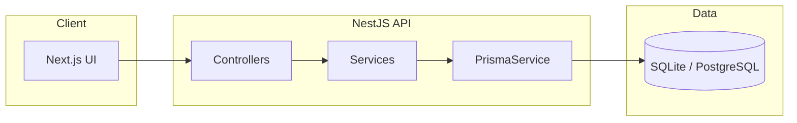
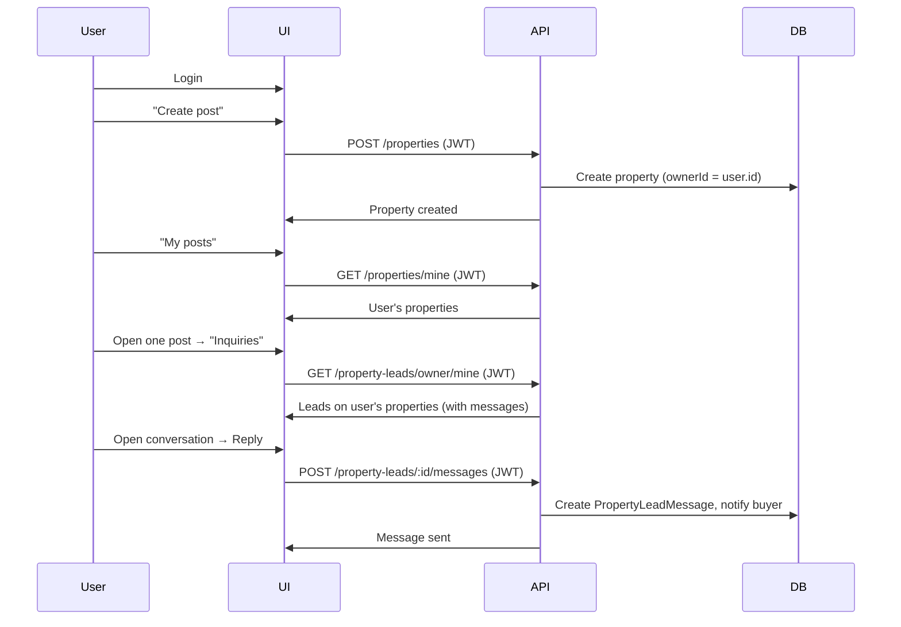
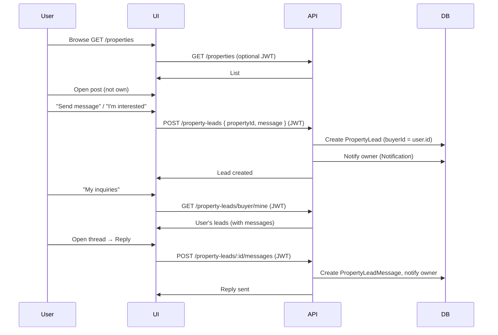
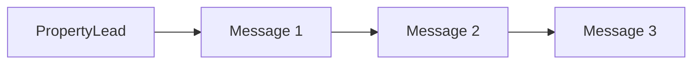

# PlotFarm Estate — End-to-End Flow

**Stack:** Next.js (frontend) + NestJS (API) + SQLite (dev) / PostgreSQL (later).

**User model:** One unified **User**. Two roles: **ADMIN** (moderation, full control) and **USER** (create posts, browse, inquire, favorite, converse). Any registered user (USER) can list plots, buy/inquire, act as dealer, contact sellers. Guests can browse; they must **register to start or continue a conversation**. Blocked (suspended) users cannot log in.

---

## 1. High-Level Architecture



---

## 2. User Capabilities (Unified User)

| Capability | Who | Notes |
|------------|-----|--------|
| Browse all posts (list + detail) | **Guest** or **User** | Public `GET /properties`, `GET /properties/:id` |
| Create a post (property/listing) | **User** | `POST /properties` (JWT required) |
| Edit / delete own post | **User** (owner) | `PATCH /properties/:id`, `DELETE /properties/:id` |
| View "My posts" | **User** | `GET /properties/mine` (JWT) |
| Show interest (send first message) | **User** only | `POST /property-leads` (JWT). Guest cannot create lead. |
| See conversations (inquiries) | **User** | As owner: `GET /property-leads/owner/mine`; as inquirer: `GET /property-leads/buyer/mine` |
| Get messages in a thread | **User** (owner or inquirer of that lead) | `GET /property-leads/:id/messages` |
| Reply in thread | **User** (owner or inquirer) | `POST /property-leads/:id/messages` |
| Favorite a post | **User** | `POST /engagement/listings/:id/favorite` (id = propertyId) |
| See favorites | **User** | `GET /engagement/favorites` |
| Moderate / verify (future) | **ADMIN** | Admin-only routes |

**Guest:** Can only browse. To send a message or favorite, they must register/login.

---

## 3. Guest Journey (Browse Only)

```mermaid
sequenceDiagram
  participant Guest
  participant UI
  participant API

  Guest->>UI: Open app
  UI->>API: GET /properties (no auth)
  API->>UI: List of posts
  Guest->>UI: Click a post
  UI->>API: GET /properties/:id (no auth)
  API->>UI: Post detail
  Guest->>UI: Click "Contact" or "Send message"
  UI->>UI: Redirect to Login/Register (no JWT)
  Guest->>UI: Register or Login
  UI->>API: POST /auth/register or POST /auth/token
  API->>UI: JWT
  Note over Guest,UI: Now treated as User; can send message
```

---

## 4. Registered User — Create Post & See Inquiries



---

## 5. Registered User — Browse, Show Interest, Conversation



---

## 6. Conversation Thread (Owner ↔ Inquirer)

- **Lead** = one inquiry on one property (one thread).
- **PropertyLeadMessage** = each message in that thread; `fromOwner` marks owner vs buyer.
- Only the **owner** of the property and the **buyer** (inquirer) can see the thread and add messages.
- New inquiry → notification to owner. New reply → notification to the other party.



---

## 7. Favorites Flow

- **User** favorites a **property** (post). Stored as `PropertyFavorite(userId, propertyId)`.
- Toggle: `POST /engagement/listings/:id/favorite` (id = propertyId). Response `{ favorited: true | false }`.
- List: `GET /engagement/favorites` returns user's favorited properties.

---

## 8. API Route Summary (Auth)

| Route | Auth | Purpose |
|-------|------|---------|
| `GET /properties` | Optional | List posts (guest or user) |
| `GET /properties/:id` | Optional | Post detail (guest or user) |
| `GET /properties/mine` | JWT | Current user's posts |
| `POST /properties` | JWT | Create post |
| `PATCH /properties/:id` | JWT (owner) | Update own post |
| `DELETE /properties/:id` | JWT (owner) | Delete own post |
| `POST /property-leads` | JWT | Create inquiry (guest cannot) |
| `GET /property-leads/owner/mine` | JWT | Inquiries on my posts |
| `GET /property-leads/buyer/mine` | JWT | My inquiries |
| `GET /property-leads/:id/messages` | JWT (owner or buyer) | Messages in thread |
| `POST /property-leads/:id/messages` | JWT (owner or buyer) | Reply in thread |
| `GET /engagement/favorites` | JWT | My favorites |
| `POST /engagement/listings/:id/favorite` | JWT | Toggle favorite (id = propertyId) |

---

## 9. Business Rules (Already Enforced)

- **Own post:** User cannot create an inquiry on their own property (`You cannot inquire on your own listing`).
- **Conversation access:** Only owner of the property or buyer of the lead can read/add messages for that lead.
- **Guest:** No JWT → cannot call `POST /property-leads` or engagement favorites; UI should prompt register/login.

---

## 10. What Is Already Implemented

- Guest can browse (GET properties without auth).
- User can create/edit/delete own post; see "My posts."
- User can create inquiry (lead) with optional message; owner gets notification.
- Conversation thread (PropertyLeadMessage) with owner/buyer reply and notifications.
- Owner sees inquiries on their posts; buyer sees their inquiries; both can continue conversation.
- Favorites (by property) and toggle favorite.
- Role is ADMIN or USER; app behavior is "unified user" for listing and inquiry flows. Signup assigns USER; only admins can create ADMIN users.

- **Schema:** [schema.md](schema.md) — tables, fields, indexes, seed.
- **Upgrades and edge cases:** [upgrades-and-edge-cases.md](upgrades-and-edge-cases.md) — security, validation, dealer flow, moderation, and future improvements.
