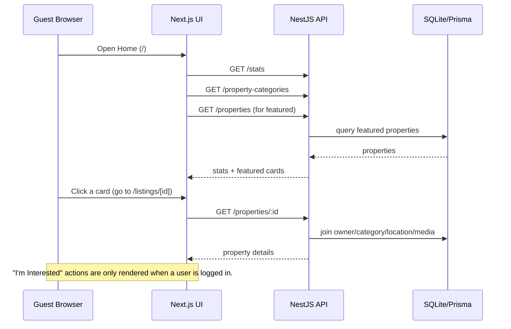
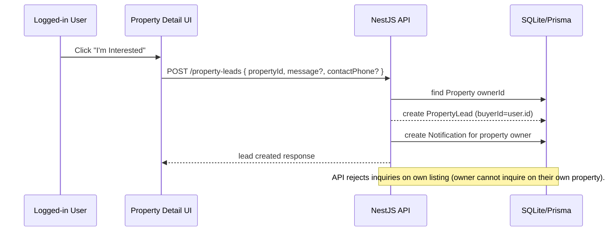
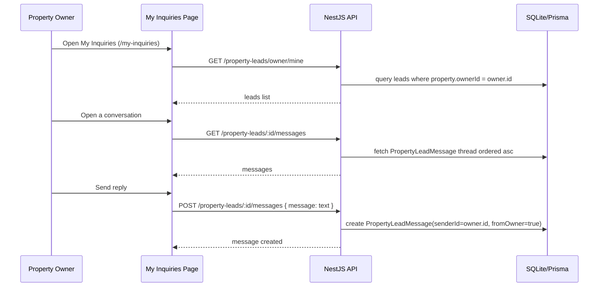
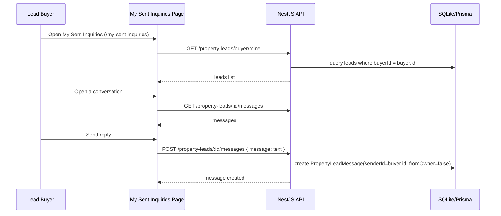
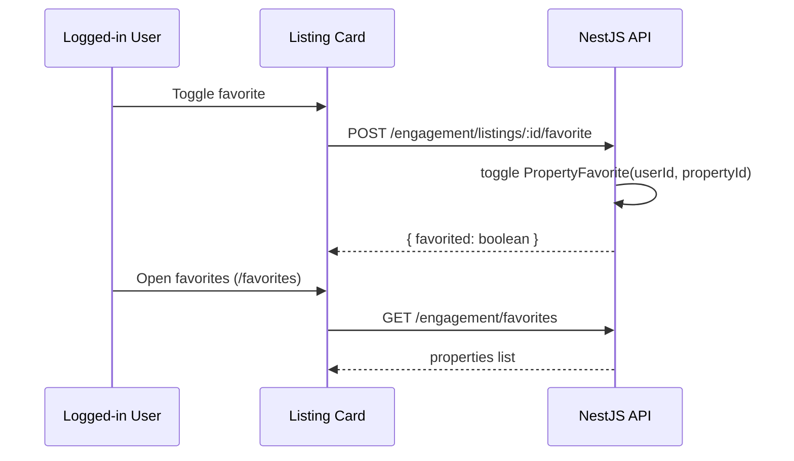

# Phase 1 Marketplace (Implemented) - End to End Flow

## What this doc is
This doc describes the **exact end-to-end behavior currently implemented in the codebase** for the marketplace experience using the existing routes and auth model.

Because PlotFarm currently uses `properties` as the core listing data model, the UI refers to them as "Listings" (`/listings`), and conversation/inquiries are handled via `property-leads`.

## Stack / runtime
- Frontend: Next.js (App Router)
- Backend: NestJS + Prisma
- DB (dev): SQLite
- DB relations: `User`, `Property`, `PropertyLocation`, `PropertyMedia`, `PropertyFavorite`, `PropertyLead`, `PropertyLeadMessage`

## Route map (UI)
Public browsing:
- `GET /` (Home) - loads stats + featured properties
- `GET /listings` (Plots/Browse Land equivalent) - browse + filter (client + server query)
- `GET /listings/[id]` - property details (gallery, title, location, price, description). Interest actions require login.

Authenticated user experience:
- `GET /my-listings` - my posted properties (JWT required)
- `GET /favorites` - my favorited properties (JWT required)
- `GET /my-inquiries` - inquiries/messages on my properties (JWT required)
- `GET /my-sent-inquiries` - inquiries/messages I sent (JWT required)

## Route map (Backend)
Public (no JWT):
- `GET /stats`
- `GET /property-categories`
- `GET /property-locations/states/distinct`
- `GET /properties` (public property browsing with filters)
- `GET /properties/:id` (public property detail)

Authenticated (JWT required):
- `POST /properties` - create a property (owner)
- `PATCH /properties/:id`, `DELETE /properties/:id` - update/delete own property
- `POST /property-leads` - submit interest/inquiry (must not be the property owner)
- `GET /property-leads/owner/mine` - get leads for properties I own
- `GET /property-leads/buyer/mine` - get leads I submitted
- `GET /property-leads/:id/messages` - message thread for the lead (owner or buyer only)
- `POST /property-leads/:id/messages` - add message to the thread (owner or buyer only)
- `GET /engagement/favorites` - my favorites
- `POST /engagement/listings/:id/favorite` - toggle favorite

## Data mapping (DB -> marketplace concepts)
The current backend uses:
- `Property` as the listing card/detail data
- `PropertyLocation` as location + `latitude/longitude` data (currently not shown on the public detail UI)
- `PropertyMedia` as images (UI shows IMAGE media URLs)
- `PropertyLead` as "inquiry" (one lead/thread per inquiry record)
- `PropertyLeadMessage` as the message thread
- `PropertyFavorite` as favorites

## End-to-end flows

### 1) Guest browsing (public)

### 2) Authenticated user submits interest (inquiry)

### 3) Owner replies (conversation)

### 4) Inquirer replies (conversation)

### 5) Favorites

## Current limitations inside the implemented flow (important)
These are not "future features"; they are limitations observed in the current implementation:
- Public listing detail has no map view even though `latitude/longitude` exists in `PropertyLocation`.
- "Interested" preloading in the UI depends on `/engagement/status` returning an `interested` list, but the backend currently returns `interested: []` always.
  - After a user clicks "I'm Interested", the UI updates local state, but preloading existing inquiries does not work.

## Where to look in code (starting points)
- Frontend:
  - `plotfarm-ui/src/app/(main)/page.tsx` (Home: stats + featured)
  - `plotfarm-ui/src/app/(main)/listings/page.tsx` (browse/filter)
  - `plotfarm-ui/src/app/(main)/listings/[id]/page.tsx` (detail + inquiry/favorite actions)
  - `plotfarm-ui/src/app/(main)/my-inquiries/page.tsx`, `.../my-sent-inquiries/page.tsx` (conversation UI)
- Backend:
  - `plotfarm-api/src/modules/properties/properties.controller.ts`, `properties.service.ts`
  - `plotfarm-api/src/modules/property-leads/property-leads.controller.ts`, `property-leads.service.ts`
  - `plotfarm-api/src/modules/engagement/engagement.controller.ts`, `engagement.service.ts`

