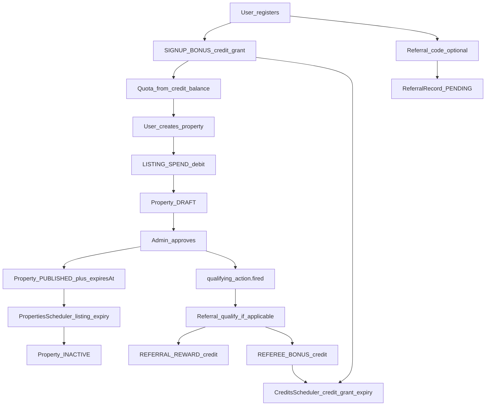

# Referrals & credits alignment

This document describes the **unified policy**, how credits/referrals/posting interact, known gaps that were addressed, and how to verify behavior.

## Product policy (canonical)

| Field | Meaning | Default |
|-------|---------|--------|
| `listingCostCredits` | Credits debited when a user **creates** a new property (draft) | 1 |
| `newUserGrantListings` | How many listings the signup grant is **worth** (at `listingCostCredits` each) | 5 |
| `newUserGrantDays` | `SIGNUP_BONUS` grant expires after this many days | 30 |
| `listingVisibilityDays` | Published listing `expiresAt` = `publishedAt` + this many days | 30 |
| `referrerReward` | Credits to referrer when referral qualifies | 2 |
| `refereeBonus` | Credits to referee when referral qualifies | 1 |
| `referralExpiryDays` | Referral record must qualify within this window | 30 |
| `enableCreditExpiry` | Scheduler removes expired free-credit grants | true |

**Signup credit amount (single source of truth):**  
`freePostingCredits = newUserGrantListings × listingCostCredits`  
(stored `signupBonus` is kept in sync when config is updated.)

**Referral qualification:** Referrer and referee rewards are issued when the referee’s **first listing is approved** (published + verified), via `qualifying_action.fired`.

**Two different “30 day” expiries (best practice):**

1. **Free credits expire** — `SIGNUP_BONUS` / `REFEREE_BONUS` rows with `expiresAt` are processed by the daily credits job.
2. **Listings expire** — After admin approval, `Property.expiresAt` is set; nightly job sets status to `INACTIVE` when past `expiresAt`.

## Flow (mermaid)

## API surfaces

| Endpoint | Purpose |
|----------|---------|
| `GET /referrals/config` | Public credit/referral config + **`policy`** object for UI copy |
| `GET /credits/balance` | Wallet balance + breakdown |
| `GET /properties/my-quota` | Posting quota derived from balance ÷ `listingCostCredits` |
| `GET /stats/me` | Dashboard; **`quota`** matches credit-based quota (same as my-quota) |

## Gaps addressed

1. **`CreditConfig` silent overwrite** — `ReferralsService.getConfig()` no longer resets admin-tuned values on every read; defaults apply only when creating the singleton row.
2. **Signup amount vs listings** — `issueSignupBonus` grants `newUserGrantListings × listingCostCredits` credits; admin `updateConfig` syncs `signupBonus` / `creditsPerListing` with canonical fields.
3. **Dashboard quota wrong** — `/stats/me` previously used monthly post counts vs `SystemConfig`; it now uses `PropertiesService.getMyQuota()` so `quota.balance` matches the wallet.
4. **UI stale after auth** — After login/register, the client refreshes credit balance (and can refetch quota on post page via existing effects).

## Verification checklist

- [ ] Register → `/credits/balance` and `/properties/my-quota` show **5** remaining (if cost is 1).
- [ ] Create draft post → balance decreases by **1**; transaction `LISTING_SPEND`.
- [ ] Approve post → listing has `expiresAt`; if user was referred, referral completes and both parties get referral credits.
- [ ] Dashboard “credits” card matches wallet (same as nav when refreshed).
- [ ] After login, nav/credits store shows non-null balance when applicable.

## Automated checks (dev)

- API: `npx tsc --noEmit -p tsconfig.build.json` (compile)
- UI: `npx tsc --noEmit`
- Unit: `npx jest src/modules/referrals/referrals.service.spec.ts`

## Files (reference)

- `src/modules/auth/auth.service.ts` — signup bonus issuance
- `src/modules/referrals/referrals.service.ts` — config, referral qualification
- `src/modules/properties/properties.service.ts` — debit on create, approval + expiry
- `src/modules/credits/credits.service.ts` — ledger, expiry processing
- `src/modules/stats/stats.service.ts` — dashboard quota aligned with credits
