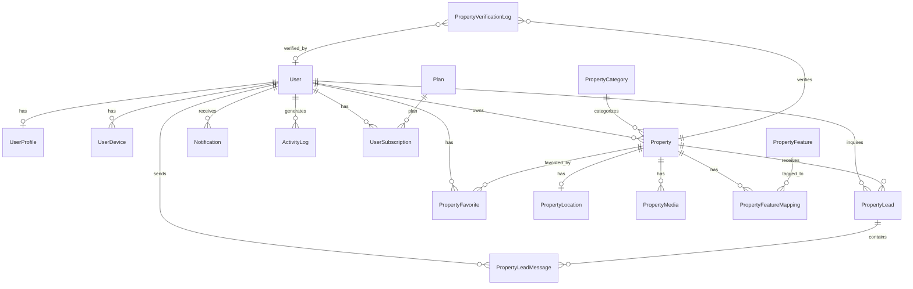

# PlotFarm Estate — Database Schema

**Purpose:** Single source of truth for the database layer. Use this to build or align the application (NestJS API + Prisma).

**DB:** SQLite (development); PostgreSQL (production later). IDs: TEXT UUID for main entities; integer auto-increment for categories, features, plans.

**User model:** One **User** type. Two roles: **ADMIN** (full system control, moderation) and **USER** (create posts, browse, send inquiries, reply, favorite). Guests cannot create leads or favorites—they must register. User **status** (ACTIVE, BLOCKED, PENDING): blocked users cannot log in.

---

## 1. Entity Relationship Overview

---

## 2. Tables and Fields

### 2.1 Users and auth

**users** (Prisma: `User`)

| Column | Type | Constraints | Notes |
|--------|------|--------------|--------|
| id | TEXT | PK | UUID, generated in app |
| full_name | TEXT | NOT NULL | |
| email | TEXT | UNIQUE, nullable | |
| phone | TEXT | UNIQUE, nullable | |
| password_hash | TEXT | NOT NULL | |
| role | TEXT | NOT NULL, CHECK | ADMIN, USER (ADMIN for moderation; USER for all other capabilities) |
| status | TEXT | DEFAULT ACTIVE, CHECK | ACTIVE, BLOCKED, PENDING |
| is_email_verified | INTEGER | DEFAULT 0 | 0/1 (SQLite boolean) |
| is_phone_verified | INTEGER | DEFAULT 0 | 0/1 |
| last_login_at | DATETIME | nullable | |
| created_at | DATETIME | DEFAULT CURRENT_TIMESTAMP | |
| updated_at | DATETIME | DEFAULT CURRENT_TIMESTAMP | |

**user_profiles** (Prisma: `UserProfile`)

| Column | Type | Constraints | Notes |
|--------|------|--------------|--------|
| id | TEXT | PK | UUID |
| user_id | TEXT | UNIQUE, NOT NULL, FK → users(id) ON DELETE CASCADE | |
| profile_image_url | TEXT | nullable | |
| address, city, state, country, pincode | TEXT | nullable | |
| kyc_status | TEXT | CHECK | NOT_SUBMITTED, PENDING, VERIFIED, REJECTED |
| kyc_document_url | TEXT | nullable | |
| created_at | DATETIME | DEFAULT CURRENT_TIMESTAMP | |

**user_devices** (Prisma: `UserDevice`)

| Column | Type | Constraints | Notes |
|--------|------|--------------|--------|
| id | TEXT | PK | UUID |
| user_id | TEXT | NOT NULL, FK → users(id) ON DELETE CASCADE | |
| device_id, device_type, ip_address, user_agent | TEXT | nullable | |
| last_login_at | DATETIME | nullable | |
| created_at | DATETIME | DEFAULT CURRENT_TIMESTAMP | |

---

### 2.2 Property core (post = property with listing info)

**property_categories** (Prisma: `PropertyCategory`)

| Column | Type | Constraints | Notes |
|--------|------|--------------|--------|
| id | INTEGER | PK, AUTOINCREMENT | |
| name | TEXT | UNIQUE, NOT NULL | e.g. PLOT, FARM_LAND, COMMERCIAL |

**properties** (Prisma: `Property`) — *One row = one post (property + listing data).*

| Column | Type | Constraints | Notes |
|--------|------|--------------|--------|
| id | TEXT | PK | UUID |
| owner_id | TEXT | nullable, FK → users(id) ON DELETE SET NULL | Post owner |
| category_id | INTEGER | nullable, FK → property_categories(id) | |
| title | TEXT | NOT NULL | |
| description | TEXT | nullable | |
| price | REAL/DECIMAL | nullable | |
| listing_type | TEXT | NOT NULL, CHECK | SALE, RENT, LEASE |
| land_area | REAL | nullable | |
| land_unit | TEXT | nullable | |
| facing | TEXT | nullable | |
| status | TEXT | DEFAULT DRAFT, CHECK | DRAFT, PUBLISHED, INACTIVE, SOLD |
| verification_status | TEXT | DEFAULT PENDING, CHECK | PENDING, VERIFIED, REJECTED |
| is_featured | INTEGER | DEFAULT 0 | 0/1 |
| slug | TEXT | UNIQUE, nullable | |
| seo_meta_title, seo_meta_description | TEXT | nullable | |
| created_at, updated_at | DATETIME | DEFAULT CURRENT_TIMESTAMP | |

**property_locations** (Prisma: `PropertyLocation`)

| Column | Type | Constraints | Notes |
|--------|------|--------------|--------|
| id | TEXT | PK | UUID |
| property_id | TEXT | UNIQUE, NOT NULL, FK → properties(id) ON DELETE CASCADE | |
| address, village, mandal, district, state, country | TEXT | nullable | |
| latitude, longitude | REAL | nullable | |

**property_media** (Prisma: `PropertyMedia`)

| Column | Type | Constraints | Notes |
|--------|------|--------------|--------|
| id | TEXT | PK | UUID |
| property_id | TEXT | NOT NULL, FK → properties(id) ON DELETE CASCADE | |
| media_url | TEXT | NOT NULL | |
| media_type | TEXT | CHECK | IMAGE, VIDEO, DOCUMENT |
| is_primary | INTEGER | DEFAULT 0 | 0/1 |
| created_at | DATETIME | DEFAULT CURRENT_TIMESTAMP | |

**property_features** (Prisma: `PropertyFeature`)

| Column | Type | Constraints | Notes |
|--------|------|--------------|--------|
| id | INTEGER | PK, AUTOINCREMENT | |
| name | TEXT | UNIQUE, NOT NULL | e.g. ROAD_ACCESS, BOREWELL |

**property_feature_mapping** (Prisma: `PropertyFeatureMapping`)

| Column | Type | Constraints | Notes |
|--------|------|--------------|--------|
| property_id | TEXT | PK, FK → properties(id) ON DELETE CASCADE | |
| feature_id | INTEGER | PK, FK → property_features(id) | |

---

### 2.3 Verification and audit

**property_verification_logs** (Prisma: `PropertyVerificationLog`)

| Column | Type | Constraints | Notes |
|--------|------|--------------|--------|
| id | TEXT | PK | UUID |
| property_id | TEXT | NOT NULL, FK → properties(id) ON DELETE CASCADE | |
| verified_by_id | TEXT | nullable, FK → users(id) ON DELETE SET NULL | |
| status | TEXT | | VERIFIED, REJECTED |
| remarks | TEXT | nullable | |
| created_at | DATETIME | DEFAULT CURRENT_TIMESTAMP | |

---

### 2.4 Leads and conversation

**property_leads** (Prisma: `PropertyLead`) — *One inquiry on one property = one thread.*

| Column | Type | Constraints | Notes |
|--------|------|--------------|--------|
| id | TEXT | PK | UUID |
| property_id | TEXT | NOT NULL, FK → properties(id) ON DELETE CASCADE | |
| buyer_id | TEXT | nullable, FK → users(id) ON DELETE SET NULL | Inquirer |
| message | TEXT | nullable | Initial message |
| contact_phone | TEXT | nullable | |
| status | TEXT | DEFAULT NEW, CHECK | NEW, CONTACTED, NEGOTIATION, CLOSED |
| created_at | DATETIME | DEFAULT CURRENT_TIMESTAMP | |

**property_lead_messages** (Prisma: `PropertyLeadMessage`)

| Column | Type | Constraints | Notes |
|--------|------|--------------|--------|
| id | TEXT | PK | UUID |
| lead_id | TEXT | NOT NULL, FK → property_leads(id) ON DELETE CASCADE | |
| sender_id | TEXT | NOT NULL, FK → users(id) ON DELETE CASCADE | |
| message | TEXT | NOT NULL | |
| from_owner | INTEGER | DEFAULT 0 | 0/1 (owner vs buyer) |
| created_at | DATETIME | DEFAULT CURRENT_TIMESTAMP | |

**property_favorites** (Prisma: `PropertyFavorite`)

| Column | Type | Constraints | Notes |
|--------|------|--------------|--------|
| user_id | TEXT | PK, FK → users(id) ON DELETE CASCADE | |
| property_id | TEXT | PK, FK → properties(id) ON DELETE CASCADE | |
| created_at | DATETIME | DEFAULT CURRENT_TIMESTAMP | |

---

### 2.5 Subscriptions (optional for MVP)

**plans** (Prisma: `Plan`)

| Column | Type | Constraints | Notes |
|--------|------|--------------|--------|
| id | INTEGER | PK, AUTOINCREMENT | |
| name | TEXT | NOT NULL | |
| price | REAL/DECIMAL | NOT NULL | |
| listing_limit | INTEGER | nullable | |
| validity_days | INTEGER | nullable | |
| created_at | DATETIME | DEFAULT CURRENT_TIMESTAMP | |

**user_subscriptions** (Prisma: `UserSubscription`)

| Column | Type | Constraints | Notes |
|--------|------|--------------|--------|
| id | TEXT | PK | UUID |
| user_id | TEXT | NOT NULL, FK → users(id) ON DELETE CASCADE | |
| plan_id | INTEGER | nullable, FK → plans(id) | |
| start_date, end_date | DATETIME | nullable | |
| status | TEXT | DEFAULT ACTIVE, CHECK | ACTIVE, EXPIRED, CANCELLED |
| created_at | DATETIME | DEFAULT CURRENT_TIMESTAMP | |

---

### 2.6 Activity and notifications

**activity_logs** (Prisma: `ActivityLog`)

| Column | Type | Constraints | Notes |
|--------|------|--------------|--------|
| id | TEXT | PK | UUID |
| user_id | TEXT | nullable, FK → users(id) | |
| entity_type, entity_id | TEXT | nullable | |
| action | TEXT | nullable | |
| metadata | TEXT | nullable | JSON |
| created_at | DATETIME | DEFAULT CURRENT_TIMESTAMP | |

**notifications** (Prisma: `Notification`)

| Column | Type | Constraints | Notes |
|--------|------|--------------|--------|
| id | TEXT | PK | UUID |
| user_id | TEXT | NOT NULL, FK → users(id) ON DELETE CASCADE | |
| title, message | TEXT | nullable | |
| is_read | INTEGER | DEFAULT 0 | 0/1 |
| created_at | DATETIME | DEFAULT CURRENT_TIMESTAMP | |

---

## 3. Indexes (recommended)

- `users(phone)` — lookup by phone
- `users(email)` — unique, often used
- `properties(owner_id)` — "My posts"
- `properties(status)`, `properties(verification_status)` — filters
- `property_leads(property_id)` — inquiries on a property
- `property_leads(buyer_id)` — "My inquiries"
- `property_favorites(user_id)` — "My favorites"
- `property_lead_messages(lead_id)` — thread messages

---

## 4. Seed data (reference)

**property_categories:** PLOT, FARM_LAND, COMMERCIAL, RENTAL (or LAYOUT per product).

**property_features:** ROAD_ACCESS, BOREWELL, ELECTRICITY, FENCING, WATER_SOURCE.

**plans:** e.g. Basic (listing_limit 5, validity_days 365).

Optional: one default admin user for moderation.

---

## 5. SQLite vs PostgreSQL

- **SQLite:** Use TEXT for UUIDs, INTEGER for booleans (0/1), REAL for decimals, CHECK for enums. **`PRAGMA foreign_keys = ON`** is set in `PrismaService.onModuleInit()` so SQLite enforces foreign keys on every connection.
- **PostgreSQL:** Same logical schema; can use native UUID/boolean/enum if desired. Foreign keys enforced by default. Connection string and driver change; migrations can be adapted from this schema.

---

## 6. Alignment with end-to-end flow

- **Post** = one row in `properties` (owner_id = user who created it).
- **Browse** = read `properties` (and related location, media, category); public.
- **Inquiry** = insert `property_leads` (buyer_id = current user); requires auth; blocked if owner_id = buyer_id.
- **Conversation** = `property_lead_messages` for that lead_id; only owner or buyer can read/write.
- **Favorites** = `property_favorites(user_id, property_id)`; requires auth.

This schema supports the flows described in [end-to-end-flow.md](end-to-end-flow.md).
